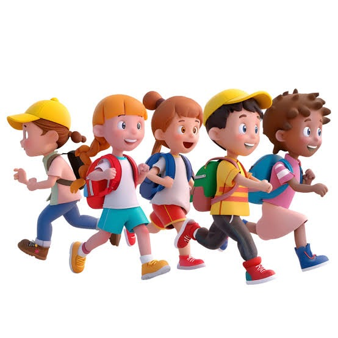
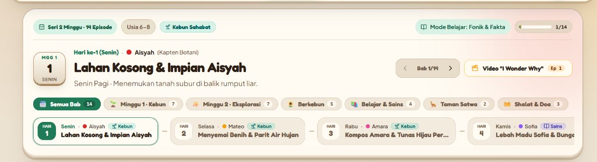
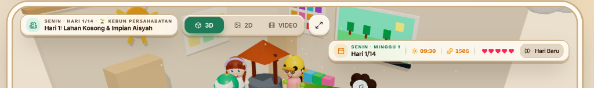
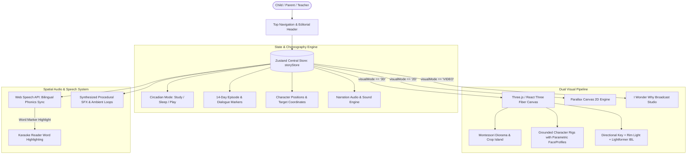

# EduKidz — Interactive 3D & 2D Educational Storytelling Platform

[](https://vitejs.dev/)
[](https://react.dev/)
[](https://threejs.org/)
[](https://docs.pmnd.rs/react-three-fiber/)
[](https://tailwindcss.com/)
[](https://www.typescriptlang.org/)
[](https://opensource.org/licenses/MIT)

> **EduKidz** is a production-grade, bilingual interactive educational storytelling platform for children aged 3–10. It integrates real-time **3D WebGL isometric dioramas (Three.js / React Three Fiber)**, **HTML5 2D Parallax illustrations**, and **"I Wonder Why" broadcast animation reels** with real-time phonics karaoke tracking, circadian sleep transitions, and tactile learning simulation.

---

## Visual Previews

### 1. Global Multicultural Friends Ensemble
Sculpted Pixar-grade 3D characters featuring procedural physical materials, distinct facial anatomy profiles (`jawScale`, `chinY`, `noseStyle`, `eyeTilt`, `mouthStyle`), non-flat depth, and grounded contact physics.



### 2. Minimalist Editorial Atelier Header & 14-Day Episode Strip
Minimalist navigation driven by **Inter** (headings & structural HUD telemetry) and **Work Sans** (narrative story subtitles), with hairline progress indicators and episode filters.



### 3. Spatial Heads-Up Stage HUD
Zero-collision floating spatial HUD featuring a unified 36px (`h-9`) telemetry horizon, mode-aware daylight/twilight circadian clock, live farm gold/crops tracking, and interactive seed-packet equipment.



---

## Key Features

- **Triple Visual Engine**:
  - **3D Isometric Diorama**: WebGL stage rendered with Three.js, React Three Fiber, PCF soft shadows, procedural canvas textures, and offline studio IBL (`<Lightformer>`).
  - **2D Layered Parallax Canvas**: Ultra-lightweight canvas fallback for lower-spec mobile tablets with zero audio desynchronization.
  - **"I Wonder Why" Video Studio**: Interactive animated broadcast cutaways, diagrammatic science explainers, and synchronized media playback.
- **Three Circadian Modes**:
  - **Study Mode (`Belajar`)**: Synchronized bilingual karaoke phonics (word-by-word highlight), vocabulary glossaries, smartboard interactions, and interactive quizzes.
  - **Sleeping Mode (`Tidur`)**: Cozy amber twilight palette, soothing ambient lullabies/ASMR soundscapes, binaural nature loops, and gradual blackout sleep timer.
  - **Playing Mode (`Main`)**: Interactive gardening simulation, D-Pad locomotion, character greeting/jumping, and hidden star quest.
- **Parametric Facial Variation (`FaceProfile`)**:
  - Eliminates generic flat spherical faces.
  - Custom cranium/jaw ratios, sculpted cheekbone volumes, distinct nose bridges/tips, articulated eyelids, and unique expressive mouth geometries (`big-laugh`, `cheerful-grin`, `warm-smile`, `curious-smirk`).
- **Inclusive Global Representation**:
  - Celebrates multicultural diversity through authentic cultural attire, skin tones, and stories across Latin America (Mateo), Europe (Sofia), East Asia (Mei-Ling & Kenji), and West Africa (Amara).
- **Audio & Speech Engine**:
  - Synthesized dual-language Web Speech narration (Indonesian `id-ID` & English `en-US`), procedural Web Audio chime/water/chuckle SFX, and multi-track volume management.

---

## Tech Stack & Architecture

### Core Technologies

| Layer | Technology | Purpose |
| :--- | :--- | :--- |
| **Runtime & Core** | React 19.3 + TypeScript 6.0 | Component rendering, strong typing, concurrent transitions |
| **Bundler & Tooling** | Vite 8.3 + Rolldown | HMR, tree-shaking, production bundle optimization |
| **3D Rendering** | Three.js + React Three Fiber + Drei | WebGL diorama, PBR physical materials, cameras, lighting |
| **Styling & Design** | Tailwind CSS v4 + PostCSS | Mode-scoped CSS variables, fluid responsive layouts |
| **Typography** | Inter & Work Sans (Google Fonts) | Optical clarity for structural UI (`Inter`) and readability for narrative prose (`Work Sans`) |
| **State Management** | Zustand 5.0 | Centralized zero-overhead reactive store with actions |
| **Audio & SFX** | Web Audio API + Web Speech API | Dual-channel narration, procedural synthesizers, and spatial ambient audio |
| **Effects & Canvas** | HTML5 2D Canvas + Canvas Confetti | 60 FPS science cutaway renderer and celebratory particles |

---

## System Architecture



---

## Character Roster (Global Friends)

| Character | Region & Heritage | Key Role | 3D Face Profile | Attire & Color Theme |
| :--- | :--- | :--- | :--- | :--- |
| **Mateo Silva** | Brazil / Latin America | Soil caretaker, bio-composter, and acoustic guitarist | Rounded nose, thick brows, `big-laugh` mouth | Yellow explorer cap, striped ochre/red tee, charcoal joggers, red high-tops |
| **Sofia Lindqvist** | Sweden / Northern Europe | Botany naturalist and seed journal recorder | Petite nose, arched brows, `cheerful-grin`, freckles | Warm ginger braids, white tee, teal shorts, red pack, mustard sneakers |
| **Mei-Ling Noor** | Singapore / East Asia | Herbal tea curator and flower grower | Petite nose, gentle brows, `warm-smile` | High bun with ribbon, white tee, red athletic shorts with yellow trim, blue pack |
| **Kenji Takahashi** | Japan / East Asia | Water architect and eco-tools designer | Nose bridge, curious-raised asymmetric brows, `curious-smirk` | Explorer cap, tortoiseshell glasses, sage jacket, denim pants, brown trail shoes |
| **Amara Okafor** | Nigeria / West Africa | Garden captain and composting coordinator | Button nose, expressive brows, `big-laugh` mouth | Textured curly afro puffs, pastel pink polo, peach skirt, blue backpack & high-tops |

---

## Directory Structure

```text
edukidz/
├── docs/                               # Engineering & pedagogical documentation
│   ├── BRD.md                          # Business Requirements Document
│   ├── PRD.md                          # Product Requirements Document
│   ├── SDD.md                          # System Design Document
│   ├── TDD.md                          # Technical Architecture & Test Specs
│   └── examples/                       # Series catalogues & lesson plans
├── web/                                # Frontend Single Page Application
│   ├── public/
│   │   ├── previews/                   # Readme screenshots & UI previews
│   │   ├── favicon.svg                 # Brand mark icon
│   │   └── icons.svg                   # SVG sprite assets
│   ├── src/
│   │   ├── components/
│   │   │   ├── 2d/                     # HTML5 2D Parallax Canvas engine
│   │   │   ├── 3d/                     # Three.js / React Three Fiber world
│   │   │   │   ├── actors/             # StylizedChildRig3D & BotanicalBuddy3D
│   │   │   │   ├── environment/        # Montessori room, crops, terrain island
│   │   │   │   ├── shaders/            # Custom GLSL character selection rings
│   │   │   │   └── textures/           # Procedural canvas textures (zero assets)
│   │   │   ├── controls/               # Playback dock & scrubber controls
│   │   │   ├── modals/                 # Quiz modal, glossary vocab, hotspot dialog
│   │   │   ├── navigation/             # Minimalist TopNavBar
│   │   │   ├── sleep/                  # Sleep sanctuary overlay & blackout timer
│   │   │   ├── stage/                  # StoryStage, FarmHud, CommandDock
│   │   │   ├── story/                  # ChapterRail, CharacterRoster
│   │   │   ├── study/                  # Bilingual KaraokeReader with phonics
│   │   │   └── video/                  # "I Wonder Why" animation studio
│   │   ├── constants/                  # Character registries & botanical presets
│   │   ├── data/                       # 14-day episodic series manifests
│   │   ├── lib/                        # Internationalization (i18n) & speech
│   │   ├── services/                   # Web Audio sound engine & narration
│   │   ├── stores/                     # Zustand central store (storyStore.ts)
│   │   ├── types/                      # TypeScript schemas & contracts
│   │   ├── App.tsx                     # Main layout & keyboard orchestrator
│   │   ├── index.css                   # Tailwind v4 theme & spatial variables
│   │   └── main.tsx                    # React DOM entry point
│   ├── package.json                    # Workspace dependencies & build scripts
│   ├── tsconfig.json                   # Strict TypeScript compiler options
│   └── vite.config.ts                  # Vite build & bundler configuration
└── README.md
```

---

## Getting Started

### Prerequisites

- **Node.js**: v20.x or higher
- **Package Manager**: `npm` (v10+), `pnpm` (v9+), or `yarn` (v1.22+)

### 1. Installation

Clone the repository and install dependencies in the `web` workspace:

```bash
git clone https://github.com/your-username/edukidz.git
cd edukidz/web
npm install
```

### 2. Running Local Development Server

Start Vite with hot module replacement:

```bash
npm run dev
```

Open [http://localhost:3000](http://localhost:3000) (or the port specified by Vite) in your browser.

### 3. Production Build & Verification

To verify TypeScript contracts and produce an optimized distribution build:

```bash
npm run build
```

To preview the production bundle locally:

```bash
npm run preview
```

---

## Keyboard Shortcuts

The platform supports accessible, child-friendly keyboard navigation:

| Key | Action |
| :--- | :--- |
| <kbd>Space</kbd> | Toggle Narration Play / Pause |
| <kbd>→</kbd> / <kbd>←</kbd> | Advance to Next / Previous Episode Chapter |
| <kbd>1</kbd> – <kbd>7</kbd> | Quick-jump directly to Day 1–7 of active week |
| <kbd>W</kbd> <kbd>A</kbd> <kbd>S</kbd> <kbd>D</kbd> or Arrows | Nudge and walk the currently selected 3D character across the garden |
| <kbd>F</kbd> | Toggle Immersive Fullscreen Mode |
| <kbd>H</kbd> | Toggle / Minimize Spatial Heads-Up Display (HUD) |
| <kbd>Esc</kbd> | Exit Fullscreen Mode |

---

## Design Principles & Performance Standards

1. **Zero External 3D Asset Loading**: All 3D characters, diorama structures, crops, and textures are procedurally generated via code geometries, procedural HTML5 canvas textures, and offline shader materials—eliminating massive GLTF network requests and guaranteeing sub-second load times.
2. **Grounded Physical Realism**: All characters stand with mathematically verified shoe sole profiles resting flush on the terrain surface (`y = 0.05`), accompanied by soft under-shoe radial contact shadows.
3. **Collision-Free Spatial Layout**: Top and bottom stage HUD bars maintain strict single-plane horizontal alignments with zero layout wrapping or overlapping cards.
4. **Accessible Contrast & Circadian Comfort**: All interactive touch targets exceed 44×44px, and typography complies with WCAG AA contrast standards across both sunny daylight and amber night-light modes.

---

## License

This project is licensed under the **MIT License** — see the [LICENSE](LICENSE) file for details.
