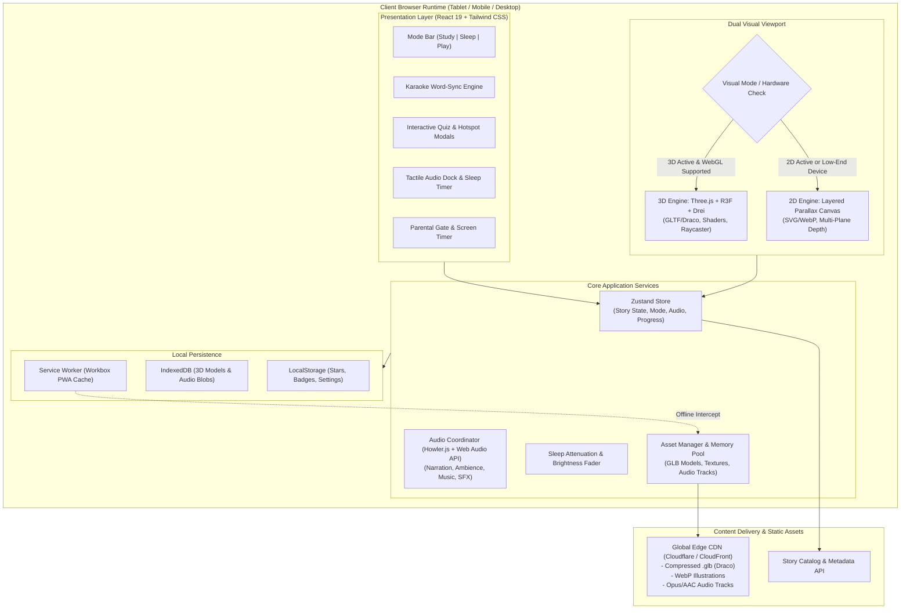
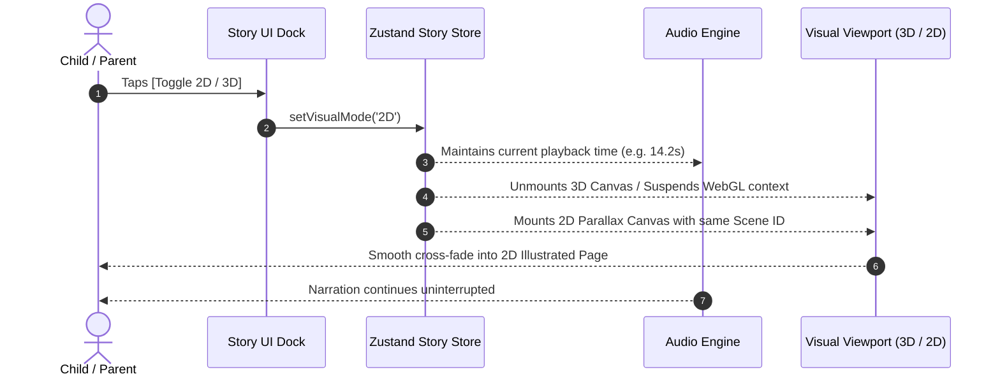

# System Design Document (SDD)
## Project: EduKidz – Interactive 3D & 2D Educational Storytelling Platform

---

### Document Control
- **Document Version:** 1.0.0
- **Lead Architect:** Principal System Architect
- **Status:** Approved for Technical Implementation
- **Location:** `docs/SDD.md`

---

## 1. System Architecture Overview

EduKidz is architected as an offline-first, client-rendered Progressive Web Application (PWA). It leverages a decoupled presentation layer, a high-performance WebGL 3D rendering pipeline powered by **Three.js** and **React Three Fiber (R3F)**, an alternate **Layered 2D Parallax Canvas**, and a synchronized **Web Audio Mixer**.

### High-Level Architecture Diagram



---

## 2. Technology Stack Selection & Technical Rationale

### 2.1 The Recommended Stack

| Layer | Chosen Technology | Why This is the Best Approach |
| :--- | :--- | :--- |
| **Framework / Bundler** | **Vite + React 19 + TypeScript** | Vite provides lightning-fast HMR and tree-shaking. React 19 offers clean concurrency for heavy UI updates while Three.js renders in a separate render-loop. |
| **3D Graphics Engine** | **Three.js + `@react-three/fiber` (R3F) + `@react-three/drei`** | R3F is the industry standard for declarative 3D web apps. It eliminates imperative Three.js boilerplate, auto-disposes GPU geometries/textures, and enables seamless React state integration. |
| **3D Asset Format** | **glTF 2.0 (.glb) with Draco Compression & KTX2 Textures** | Reduces 3D model file size by 70–85%. KTX2 (Basis Universal) uploads directly to GPU VRAM without CPU decompression spikes, preventing frame drops on budget tablets. |
| **2D Fallback Engine** | **HTML5 2D Canvas + Framer Motion Parallax** | Guarantees instant 60 FPS on older phones, low-power Chromebooks, or battery-saving modes where WebGL is throttled. |
| **Audio Architecture** | **Howler.js + Web Audio API Custom Mixer** | Provides seamless multi-track playback (narration, ambience, music, SFX), true HTML5 Audio fallback, spatial sound positioning, and millisecond-accurate time tracking. |
| **State Management** | **Zustand** | Zero-boilerplate, micro-sized (< 1KB), outside-React subscriber support (essential for the 60 FPS Three.js `useFrame` loop without triggering React component re-renders). |
| **Styling & Theming** | **Tailwind CSS v4 + CSS Custom Properties** | Instant theme swapping (Bright Day, Warm Amber Twilight, Playful Neon) with GPU-accelerated CSS filters (`backdrop-filter`, brightness curves). |
| **Local Storage & Offline** | **IndexedDB (`idb-keyval`) + Workbox PWA** | Allows storing 50MB+ of 3D models and high-quality voice audio locally for smooth offline bedtime reading. |

---

## 3. Subsystem Architectural Designs

### 3.1 3D Scene Graph & Interactive Raycasting Pipeline
The 3D scene functions as an interactive diorama. 
- **Camera Rig:** Uses `@react-three/drei/CameraControls` with custom bounding spheres to prevent children from orbiting outside the viewable diorama.
- **Raycasting:** Taps on 3D meshes trigger custom event handlers via Three.js raycasting:
  ```
  Pointer Tap -> Three.js Raycaster -> Intersect Object3D 
              -> Match Mesh 'userData.interactionId'
              -> Dispatch Story Action (Play Sound, Trigger Animation, Show Fact Card)
  ```
- **Performance Budget & LOD:**
  - Max Draw Calls: < 45 per frame.
  - Max Triangles: < 60,000 vertices per scene.
  - Shadow Maps: Soft directional shadow baked into ground plane or low-resolution dynamic PCF shadow map (512x512).

### 3.2 Dual Visual Engine (3D vs 2D) Synchronizer
A critical feature is the ability to toggle between 3D and 2D mode seamlessly.
- Both `Scene3D` and `Scene2D` subscribe to the same `useStoryStore` state.
- Switching modes does **not** reset narration or ambient audio.
- The 2D mode displays a layered parallax illustration with foreground, midground (characters), and background planes, reacting to touch drag or device gyroscope tilt.



### 3.3 Audio-Visual Karaoke Synchronization Pipeline
For **Study Mode**, word-by-word reading synchronization must remain sub-50ms accurate across devices:
1. Story scene defines word markers with absolute milliseconds from audio start:
   `[{ word: "Barnaby", start: 800, end: 1250 }, ...]`
2. An animation frame ticker (`requestAnimationFrame`) reads `audioPlayer.seek()`.
3. The active word index is calculated in constant time $O(1)$ and updated via CSS class `.word-active-karaoke`.
4. This avoids heavy React virtual DOM re-renders by updating lightweight CSS variables or direct DOM nodes.

### 3.4 Sleeping Mode Circadian Decay Engine
When Sleeping Mode is engaged:
1. **Color Shift:** A global CSS filter and Three.js ambient light controller smoothly interpolates color temperature from 5000K (neutral daylight) to 2200K (candlelight amber) over 10 seconds.
2. **Audio Decay Curve:** An automated sleep timer applies an exponential decay algorithm over the final 3 minutes:
   $$V(t) = V_{\text{initial}} \times \left(1 - \frac{t}{T_{\text{decay}}}\right)^2$$
3. **Screen Dimming & Blackout:** Screen brightness drops incrementally. Once complete, screen locks to pure black (`#000000`), reducing OLED battery drain and light pollution in the bedroom.

---

## 4. Data Flow & State Management (Zustand Store Schema)

```typescript
interface StoryState {
  // Current Story & Scene
  currentStoryId: string | null;
  currentSceneIndex: number;
  totalScenes: number;
  
  // Modality & Visual Mode
  activeMode: 'study' | 'sleeping' | 'playing';
  visualMode: '3D' | '2D';
  
  // Audio Mixer State
  isPlaying: boolean;
  playbackSpeed: 0.75 | 1.0 | 1.25;
  volumeNarration: number; // 0.0 - 1.0
  volumeAmbience: number;  // 0.0 - 1.0
  volumeSfx: number;       // 0.0 - 1.0
  currentTimeMs: number;
  activeWordIndex: number;
  
  // Sleep Timer
  sleepTimerMinutes: number | null;
  sleepTimerRemainingMs: number | null;
  isBlackoutActive: boolean;
  
  // Study & Gamification
  earnedStars: number;
  unlockedHotspots: string[];
  
  // Actions
  setMode: (mode: 'study' | 'sleeping' | 'playing') => void;
  toggleVisualMode: () => void;
  playPause: () => void;
  nextScene: () => void;
  prevScene: () => void;
  triggerHotspot: (hotspotId: string) => void;
  startSleepTimer: (minutes: number) => void;
  wakeFromSleep: () => void;
}
```

---

## 5. Offline Storage & Asset Management Strategy

1. **Pre-caching on Story Selection:**
   - When a story is opened, the `AssetManager` triggers an asynchronous cache-ahead task.
   - The scene's `.glb` file, 2D WebP fallback, and audio files are fetched and cached via `CacheStorage` / `IndexedDB`.
2. **Memory Cleanup on Scene Transition:**
   - WebGL memory leaks are a common failure in Three.js web apps.
   - On scene transition, all geometries, textures, and materials from the departing scene are recursively traversed and `.dispose()` is called on each resource.
3. **PWA Manifest:**
   - Configured with `display: "standalone"`, `orientation: "any"`, preventing browser address bar interference during full-screen reading.

---

## 6. Safety, Privacy, and COPPA Guardrails

- **Zero Third-Party Telemetry:** No Google Analytics or Facebook SDKs tracking children.
- **Local-First Progress:** Reading badges, unlocked stickers, and settings reside in `IndexedDB`/`LocalStorage`.
- **Grown-Up Gatekeeper Modal:** Guarded by dynamic arithmetic questions (e.g., random multiplication/addition) before entering any external link or subscription setting.
