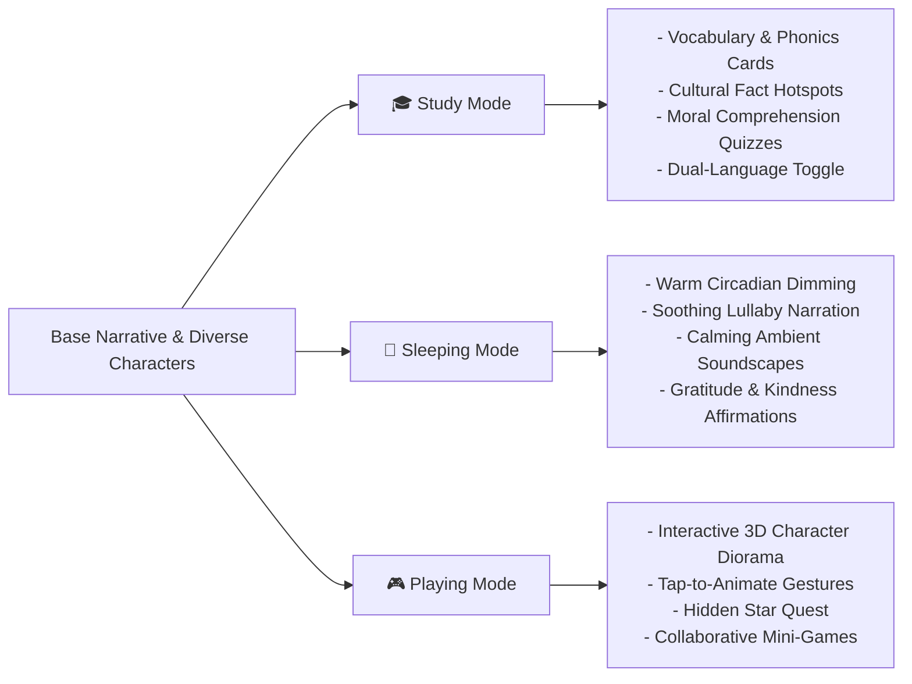

# EduKidz Storytelling & Inclusivity Guidelines
## Framework for Culturally Diverse, Bilingual, and Interfaith-Harmonious Children's Stories

---

### Document Control
- **Document Title:** EduKidz Master Storytelling & Content Inclusivity Guidelines
- **Target Audience:** Content Creators, 3D Artists, Authors, Translators, Curriculum Designers, AI Prompt Engineers
- **Version:** 1.0.0
- **Status:** Canonical Standard
- **Location:** `docs/STORYTELLING_GUIDELINES.md`
- **Companion Template:** `docs/templates/SERIES_DOCS_TEMPLATE.md`

---

## 1. Executive Vision & Core Pillars

EduKidz believes that every child deserves to see themselves reflected as the hero of a story, while discovering the beauty of other cultures, languages, and beliefs with empathy and curiosity. 

Every story published on EduKidz must uphold **Four Inviolable Pillars**:

```
┌─────────────────────────────────────────────────────────────────────────┐
│                     THE FOUR STORYTELLING PILLARS                       │
├────────────────────┬────────────────────┬───────────────────────────────┤
│ 1. SERIES & DOCS   │ 2. BILINGUAL CORE  │ 3. GLOBAL DIVERSITY & ATTIRE  │ 4. RELIGIOUS TOLERANCE │
│ Every story series │ Dual EN & ID       │ Worldwide ethnicities; normal │ Interfaith harmony,    │
│ includes companion │ narration, karaoke │ casual clothes & hijab;       │ mutual respect, unity  │
│ pedagogical docs.  │ text, and phonics. │ authentic representations.    │ in shared human values.│
└────────────────────┴────────────────────┴───────────────────────────────┘
```

---

## 2. Pillar 1: Series Architecture & Companion "Docs Series"

Every story released on the platform must belong to an overarching **Series**, and every Series MUST be accompanied by a standardized **Series Documentation Package** (`series_docs/`).

### 2.1 The Two-Tier Architecture
1. **The Interactive Storytelling Package (Story Series):**
   - 3 to 6 episodic chapters per story arc.
   - Complete 3D dioramas + 2D parallax canvas scenes.
   - Multi-channel audio (narration, ambient soundscape, music, SFX) in both languages.
   - Tri-modal adaptability (Study Mode, Sleeping Mode, Playing Mode).

2. **The Companion Documentation Series (Series Docs):**
   - Every series must include an accompanying educational dossier located under `series/<series-id>/DOCS.md`.
   - The Series Docs ensure that parents, educators, and curriculum partners understand the developmental impact, moral lessons, and linguistic scaffolding of the series.

### 2.2 Mandatory Components of the Series Docs
Each Series Documentation file must conform to [SERIES_DOCS_TEMPLATE.md](file:///c:/Users/user/Documents/GitHub/edukidz/docs/templates/SERIES_DOCS_TEMPLATE.md) and include:
- **Curriculum & Developmental Blueprint:** Target age (3–5, 6–8, or 9–10), cognitive milestones, and STEM/SEL (Social-Emotional Learning) outcomes.
- **Character Roster & Inclusivity Dossier:** Cultural origins, ethnic backgrounds, clothing rationale (everyday modern casual, hijab, cultural attire), personality traits, and positive role-modeling.
- **Interfaith & Tolerance Matrix:** Which universal moral values and interfaith harmony themes are explored (e.g., sharing sacred holiday meals, respecting prayer times, collaborative problem solving).
- **Bilingual Phonics & Vocabulary Glossary:** Key vocabulary in both English and Indonesian with phonetic breakdowns and child-friendly definitions.
- **Parent & Teacher Engagement Guide:** Pre-reading conversation starters, during-reading questions, and bedtime wind-down reflection prompts.

---

## 3. Pillar 2: Bilingual Engine (English & Indonesian)

Every story series must be natively created and synchronized in **English (EN)** and **Indonesian (Bahasa Indonesia - ID)**. Bilingualism is treated as equal first-class citizens, not an afterthought machine translation.

### 3.1 Localization Principles
- **No Mechanical Translation:** Stories are transcreated. Cultural idioms and wordplay must feel natural to both an English speaker (Global/International) and an Indonesian child (*Bahasa Indonesia yang santun, hangat, dan komunikatif*).
- **Tone & Voice Acting:**
  - **English (EN):** Clear, warm, enunciated International/Global English (accessible to non-native learners).
  - **Indonesian (ID):** Warm, friendly Indonesian (*baku namun luwes*, using respectful addressing like *kakak, adik, ibu, ayah, teman-teman*).
- **Parallel Karaoke Word-Sync:**
  - Every word marker in both languages contains precise millisecond timestamps (`startMs`, `endMs`) for karaoke highlighting.
  - Sentence length may differ between languages; audio timing must be independently timestamped per language track.

### 3.2 Dual-Language Audio & Text Schema
```typescript
interface LocalizedNarrative {
  en: {
    title: string;
    text: string;
    audioUrl: string;
    words: WordMarker[];
    vocabDefinitions: Record<string, string>;
  };
  id: {
    title: string;
    text: string;
    audioUrl: string;
    words: WordMarker[];
    vocabDefinitions: Record<string, string>;
  };
}
```

---

## 4. Pillar 3: Global Character Diversity & Inclusive Attire

Children form their perception of the world through the media they consume. EduKidz champions global diversity by portraying characters from varied ethnic backgrounds, skin tones, hair types, and clothing styles.

### 4.1 Global Ethnicities Roster
Characters across stories must represent our interconnected planet:
- **Southeast Asian:** Indonesian (Javanese, Sundanese, Minang, Papuan, Dayak, Balinese), Malaysian, Filipino, Vietnamese, Thai.
- **East & South Asian:** Japanese, Chinese, Korean, Indian, Pakistani, Bangladeshi.
- **Middle Eastern & North African (MENA):** Arab, Persian, Turkish, Egyptian, Moroccan.
- **Sub-Saharan African:** Nigerian, Kenyan, Ethiopian, Ghanaian, South African.
- **European & Americas:** Scandinavian, Celtic, Mediterranean, Indigenous Americas, Afro-Latino, North American.

### 4.2 Attire & Clothing Guidelines: Normal Modern Clothes & Hijab
To normalize cultural and religious diversity naturally, clothing must be depicted with care and contemporary authenticity:

| Attire Category | Visual & Narrative Guidelines | Example Representation |
| :--- | :--- | :--- |
| **Everyday Contemporary Casual** | Hoodies, denim jackets, overalls, sneakers, graphic t-shirts, rain boots, sporty shorts and pants. Reflects modern kids everywhere. | *Liam* wearing a blue windbreaker and bright yellow sneakers jumping in rain puddles. |
| **Hijab & Modest Fashion** | Modest, modern, and cheerful clothing for girls and women who observe the hijab. Hijabs should come in playful pastels, florals, and sporty breathable designs suitable for energetic play. | *Aisyah* wearing a pastel-mint athletic hijab, a denim jacket, and running shoes, actively leading a tree-planting adventure. |
| **Traditional & Cultural Attire** | Worn during cultural celebrations, storytelling about heritage, or community festivals. Must be authentic and respectful (Batik, Kebaya, Sarong, Kimono, Hanbok, Kurta, Kente cloth). | *Raka* wearing a casual modern Batik shirt during a neighborhood feast, explaining its motifs to friends. |
| **Religious Headwear & Modesty** | Natural inclusion of diverse headwear when appropriate (Kupiah/Peci, Turban/Patka, Kippah, Headscarves) without exoticizing or turning them into plot conflicts. | *Dev* wearing a red patka (turban) playing soccer alongside *Budi* wearing a peci. |

### 4.3 3D Character Modeling & 2D Art Rules
1. **No Stereotypical Caricatures:** Features, noses, eyes, and skin tones must be crafted with dignity and beauty. Avoid exaggerated traits.
2. **Fabric & Movement Fidelity:**
   - 3D models of characters wearing hijab or scarves must have natural cloth physics or smooth weight-painting that moves gracefully with head turns and jumps.
   - Clothing shaders should use warm, tactile toon-shading with soft specular highlights.
3. **Agency & Empowerment:**
   - Girls wearing hijab must have equal agency, physical activity, and leadership roles (climbing trees, solving science problems, piloting spaceships, playing sports).
   - Characters of all ethnicities are depicted as innovators, artists, peacemakers, and explorers.

---

## 5. Pillar 4: Religious & Cultural Tolerance Framework

EduKidz stories nurture peaceful coexistence, empathy, and mutual respect among children of all faiths (Islam, Christianity, Catholicism, Hinduism, Buddhism, Confucianism, and global wisdom traditions).

### 5.1 The Principles of Interfaith Harmony
1. **Focus on Shared Human Values:**
   - Compassion (*Kasih Sayang*), Honesty (*Kejujuran*), Charity & Helping Others (*Gotong Royong*), Gratitude (*Rasa Syukur*), and Protecting Nature (*Menjaga Alam*).
2. **Normalizing Friendship Across Differences:**
   - Stories portray diverse friendship circles where differences in faith, food traditions, and prayer times are met with natural kindness and curiosity, never division.
   - Example: Friends reminding each other politely when it is time to pray, or helping a friend find vegetarian or halal food at a picnic.
3. **Celebrating Each Other's Joy (Shared Holidays & Festivals):**
   - Sharing treats during Eid al-Fitr (*Ketupat*), exchanging gifts and goodwill during Christmas, lighting lanterns for Diwali or Vesak, sharing mooncakes during Mid-Autumn Festival.
   - The focus is on the warmth of community, generosity, and neighborly love.
4. **Non-Dogmatic & Non-Preachy:**
   - Stories do not debate theological superiority or religious doctrine.
   - Faith is presented as a personal source of kindness, peace, and family comfort.

### 5.2 Content Guardrail: The "Do and Don't" Guide

| DO (Encouraged) | DON'T (Strictly Forbidden) |
| :--- | :--- |
| Show characters with different clothing (hijab, casual, traditional) working together to solve problems. | Never present one religion or culture as superior, exclusive, or enlightened over others. |
| Portray children respectfully asking curious questions ("Why do you wear a hijab?", "It helps me feel close to God and reminds me to be kind!"). | Never depict religious or cultural garb as oppressed, strange, backward, or comical. |
| Incorporate indigenous values like Indonesia's *Bhinneka Tunggal Ika* (Unity in Diversity) and global civic friendship. | Never include proselytization, conversion storylines, or theological disputes. |
| Highlight shared experiences: bedtime fears, love for animals, wonder at the stars, helping a lost friend. | Never use religion or race as a source of antagonism, villains, or stereotypes. |

---

## 6. Story Adaptation Across the 3 Application Modes

Each story in a series must be designed to dynamically flex into EduKidz's three modalities:



### 6.1 🎓 Study Mode: Educational Enrichment
- **Knowledge Hotspots on Cultural & Scientific Elements:** Tapping a character's clothing or an architectural landmark opens a bilingual knowledge card:
  - *Example:* Tapping on Aisyah's Batik scarf: *"Batik is a traditional Indonesian wax-resist fabric art recognized by UNESCO as world heritage!"* / *"Batik adalah seni kain tradisional Indonesia yang diakui dunia!"*
- **Moral & Social Comprehension Quizzes:** Mini-quizzes focus on comprehension and empathy (e.g., *"How did Budi show kindness to his new neighbor?"*).

### 6.2 🌙 Sleeping Mode: Circadian Harmony & Comfort
- **Calming Cadence:** Narration slows to 0.85x speed with warm, gentle inflection in both English and Indonesian.
- **Universal Bedtime Themes:** Looking up at the same moon, resting after a day of helping friends, feeling safe and protected by family and loved ones.
- **Zero Conflict or Startling SFX:** Smooth ambient audio (night breeze, distant flute, soft acoustic strings).

### 6.3 🎮 Playing Mode: Tactile Exploration & Expression
- **Character Micro-Animations:** Tapping characters triggers cheerful, respectful actions:
  - High-fiving a friend, adjusting their hijab or backpack playfully, waving enthusiastically, performing a traditional greeting gesture.
- **Collaborative Story Quests:** Finding stars hidden together, helping a friend cross a bridge, or tending a community garden.

---

## 7. Quality Assurance & Review Workflow

Before any series or story is approved for production, it must pass this 5-stage verification:

```
[1. Concept & Docs Pitch] ──> [2. Inclusivity & Sensitivity Audit] ──> [3. Bilingual Translation Review]
                                                                                   │
[5. Final In-Engine Signoff] <── [4. 3D/2D Asset & Cultural Attire Check] <───────┘
```

1. **Stage 1: Concept & Series Docs Review:** Series outline and `DOCS.md` must be completed and reviewed for curriculum alignment.
2. **Stage 2: Inclusivity & Cultural Sensitivity Audit:** Checked against Section 4 & 5 rules. Ensure characters have dignified representation and zero tokenism.
3. **Stage 3: Bilingual Translation Review:** Native English and native Indonesian language editors verify grammar, emotional resonance, and vocabulary accuracy.
4. **Stage 4: 3D/2D Asset Inspection:** Check model textures, clothing shaders (hijab drape, modesty, neat casual wear), skin tone palettes, and lighting.
5. **Stage 5: Tri-Modal In-Engine Verification:** Verify smooth execution across Study, Sleeping, and Playing modes with zero audio desynchronization.

---

## 8. Special Framework: Indonesian Civic Heritage, Pancasila & National Sovereignty (TKDN)

For stories under the **Indonesian Civic Heritage & Sovereignty** category, stories must bridge national identity, ethical principles, and economic self-reliance through age-appropriate narratives:

### 8.1 Core Thematic Strands
1. **Pancasila in Daily Childhood:** 
   - Not taught as dry memorization, but lived experiences (Sila 1: gratitude for nature and respecting prayers; Sila 2: kindness to all; Sila 3: unity of diverse friends; Sila 4: *musyawarah* and listening; Sila 5: fair sharing).
2. **Kemerdekaan & Merdeka Belajar:** 
   - Freedom to discover, innovate, express creativity, and take pride in one's identity.
3. **Kedaulatan & Berdikari (Self-Reliance):** 
   - Standing proudly on our own feet. Relying on local wisdom, local agriculture, and domestic creativity instead of passive dependency on imports.
4. **Cinta & Bangga Produk Dalam Negeri:** 
   - Understanding that buying local shoes, books, fruit, and crafts directly sustains our neighbors, farmers, and artisans.
5. **Mengapa TKDN (Tingkat Komponen Dalam Negeri) Penting Bagi Anak:**
   - Explained through tangible mechanical metaphors (e.g., building toys, water pumps, or solar boats with local bamboo, rubber, and domestic parts).
   - High local content means we can fix things immediately, master technical skills, and build a self-sufficient nation.

### 8.2 Age Scaffolding Matrix
- **Ages 3–5:** Concrete sensory joy (tasting sweet local bananas and mangosteens, touching soft batik, singing national lullabies).
- **Ages 6–8:** Community fairness (*musyawarah* rules in games, supporting neighborhood artisans, making toys from local clay/wood).
- **Ages 9–10:** Causal reasoning, technological sovereignty, calculating TKDN in interactive 3D science projects, and national resilience.

*For full episode outlines, character dossiers (Tim Garuda Muda), and interactive 3D mode specs, see [docs/series/SERIES_INDONESIA_BERDAULAT_DOCS.md](file:///c:/Users/user/Documents/GitHub/edukidz/docs/series/SERIES_INDONESIA_BERDAULAT_DOCS.md).*

