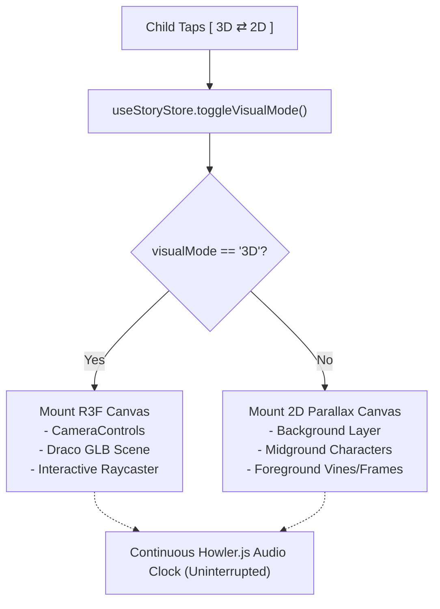
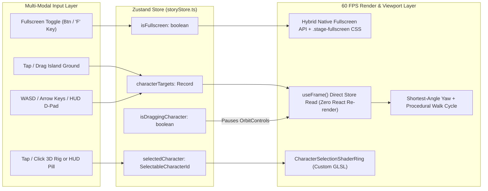
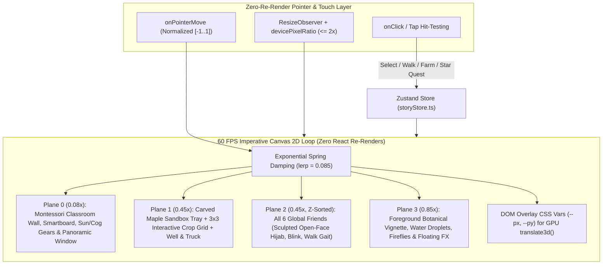
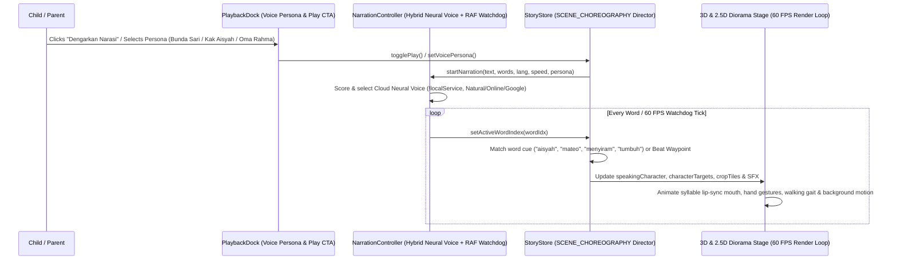
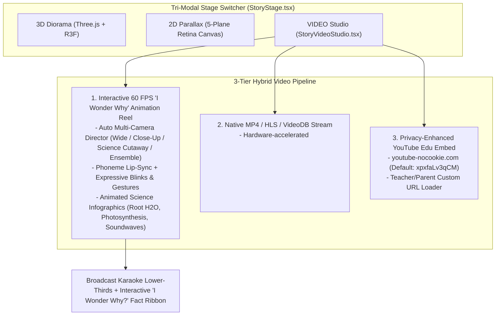
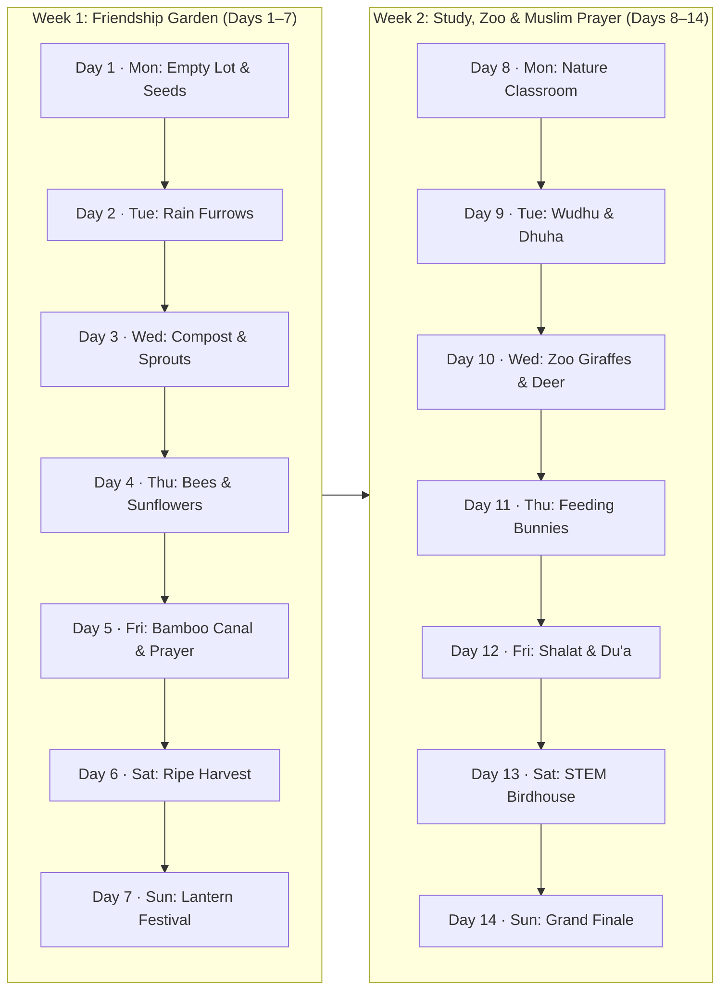

# Web Stack Implementation Approach: EduKidz Interactive Story Platform
## Architectural Guide & Engineering Blueprint for Web-Based 3D/2D Bilingual Stories

---

### Document Control
- **Document Title:** Web Stack Implementation Approach & Engineering Blueprint
- **Focus:** Vite + React 19 + TypeScript + Three.js / React Three Fiber + 2D Parallax + Bilingual Audio Sync
- **Location:** `docs/WEB_STACK_IMPLEMENTATION_APPROACH.md`
- **Related Specs:** [docs/SDD.md](file:///c:/Users/user/Documents/GitHub/edukidz/docs/SDD.md), [docs/TDD.md](file:///c:/Users/user/Documents/GitHub/edukidz/docs/TDD.md), [docs/series/EIGHT_INTERFAITH_HARMONY_SERIES_CATALOG.md](file:///c:/Users/user/Documents/GitHub/edukidz/docs/series/EIGHT_INTERFAITH_HARMONY_SERIES_CATALOG.md)

---

## 1. Why This Tech Stack is the Gold Standard for EduKidz

Creating interactive children's stories on the web requires balancing three demanding requirements:
1. **Low Friction & High Accessibility:** Must load instantly on low-end budget tablets, iPads, and Chromebooks without app store downloads.
2. **Visual & Auditory Richness:** Dynamic 3D cartoon worlds with responsive touch interactions, plus a lightweight 2D fallback for battery conservation.
3. **Sub-50ms Bilingual Synchronization:** Seamlessly synchronizing spoken English and Indonesian words with visual text highlighting while running at 60 FPS.

```
┌────────────────────────────────────────────────────────────────────────┐
│                        EDUKIDZ TECHNOLOGY STACK                        │
├─────────────────────┬──────────────────────────────────────────────────┤
│ Web Runtime         │ Vite + React 19 + TypeScript                     │
│ 3D Rendering        │ Three.js + @react-three/fiber (R3F) + drei       │
│ 3D Asset Pipeline   │ glTF 2.0 (.glb) + Draco Mesh Compression + KTX2  │
│ 2D Fallback Viewport│ HTML5 Canvas 2D + CSS Transform Parallax Layers  │
│ Audio Architecture  │ Howler.js + Web Audio API 4-Channel Mixer        │
│ State Management    │ Zustand (Decoupled, zero-overhead outside React) │
│ Theming & UI        │ Tailwind CSS v4 + Dynamic CSS Custom Properties  │
│ Offline & Storage   │ Service Worker (Workbox PWA) + IndexedDB (idb)   │
└─────────────────────┴──────────────────────────────────────────────────┘
```

---

## 2. Core Architectural Subsystems

### 2.1 The Dual Visual Viewport (3D ⇄ 2D Seamless Swapper)
The system renders either a 3D WebGL diorama or a 2D layered parallax illustration depending on user preference or hardware capability.
- **Hardware Autodetection:** If the device GPU fails WebGL2 checks or framerate drops below 24 FPS, the engine gracefully offers an automatic switch to 2D Mode.
- **Audio Continuity:** Switching visual modes does **not** re-render or pause the audio engine. The current playback timestamp is strictly preserved.



### 2.2 Live Bilingual Switcher (English ⇄ Indonesian)
When the user toggles `[ 🇮🇩 ID ⇄ 🇬🇧 EN ]`:
1. The engine checks the current audio seek position (e.g., $14.2\text{ seconds}$).
2. It fetches the matching word timestamp index from the newly selected language's dialogue track.
3. Narration cross-fades over 200ms into the corresponding audio track without rewinding the chapter.
4. Knowledge cards, subtitles, and quiz text update instantaneously via reactive Zustand state.

---

## 3. Concrete Implementation Code Patterns

### 3.1 Central State Management (`src/stores/storyStore.ts`)
Zustand is chosen because it allows the Three.js 60 FPS render loop (`useFrame`) to read state directly without triggering heavy React component re-renders.

```typescript
// src/stores/storyStore.ts
import { create } from 'zustand';
import { StoryMode, VisualMode, LanguageCode, SeriesManifest, StoryManifest, SceneDefinition } from '../types/story';

interface StoryState {
  // Localization & Mode
  language: LanguageCode;
  activeMode: StoryMode;
  visualMode: VisualMode;
  
  // Active Series & Story
  currentSeries: SeriesManifest | null;
  currentStory: StoryManifest | null;
  currentSceneIndex: number;
  
  // Audio Mixer State
  isPlaying: boolean;
  playbackSpeed: number;
  currentAudioMs: number;
  activeWordIndex: number;
  
  // Sleep Engine State
  sleepTimerMinutes: number | null;
  sleepRemainingMs: number | null;
  isBlackoutScreen: boolean;

  // Actions
  setLanguage: (lang: LanguageCode) => void;
  setMode: (mode: StoryMode) => void;
  toggleVisualMode: () => void;
  setAudioTime: (ms: number) => void;
  setActiveWordIndex: (index: number) => void;
  loadSeries: (manifest: SeriesManifest) => void;
  nextScene: () => void;
  prevScene: () => void;
}

export const useStoryStore = create<StoryState>((set, get) => ({
  language: 'id', // Default to Indonesian, toggleable to English
  activeMode: 'study',
  visualMode: '3D',
  currentSeries: null,
  currentStory: null,
  currentSceneIndex: 0,
  isPlaying: false,
  playbackSpeed: 1.0,
  currentAudioMs: 0,
  activeWordIndex: -1,
  sleepTimerMinutes: null,
  sleepRemainingMs: null,
  isBlackoutScreen: false,

  setLanguage: (language) => set({ language }),
  setMode: (activeMode) => set({ activeMode }),
  toggleVisualMode: () => set((state) => ({ visualMode: state.visualMode === '3D' ? '2D' : '3D' })),
  setAudioTime: (currentAudioMs) => set({ currentAudioMs }),
  setActiveWordIndex: (activeWordIndex) => set({ activeWordIndex }),
  loadSeries: (manifest) => set({ 
    currentSeries: manifest, 
    currentStory: manifest.stories[0] || null, 
    currentSceneIndex: 0 
  }),
  nextScene: () => {
    const { currentStory, currentSceneIndex } = get();
    if (currentStory && currentSceneIndex < currentStory.scenes.length - 1) {
      set({ currentSceneIndex: currentSceneIndex + 1, activeWordIndex: -1, currentAudioMs: 0 });
    }
  },
  prevScene: () => {
    const { currentSceneIndex } = get();
    if (currentSceneIndex > 0) {
      set({ currentSceneIndex: currentSceneIndex - 1, activeWordIndex: -1, currentAudioMs: 0 });
    }
  }
}));
```

### 3.2 High-Performance 3D Scene Viewport (`src/components/3d/Scene3DCanvas.tsx`)
Uses React Three Fiber, OrbitControls with constrained spherical limits (preventing children from losing camera focus), toon materials, and interactive pointer raycasting:

```tsx
// src/components/3d/Scene3DCanvas.tsx
import React, { Suspense } from 'react';
import { Canvas } from '@react-three/fiber';
import { OrbitControls, useGLTF, Html } from '@react-three/drei';
import { useStoryStore } from '../../stores/storyStore';

interface Scene3DProps {
  modelUrl: string;
  onHotspotClick?: (hotspotId: string) => void;
}

function SceneModel({ modelUrl, onHotspotClick }: Scene3DProps) {
  const { scene } = useGLTF(modelUrl);
  const activeMode = useStoryStore((s) => s.activeMode);

  return (
    <primitive 
      object={scene} 
      onPointerDown={(e: any) => {
        e.stopPropagation();
        const clickedMesh = e.object.name;
        if (clickedMesh.includes('Aisyah') || clickedMesh.includes('Hotspot')) {
          onHotspotClick?.(clickedMesh);
        }
      }}
    />
  );
}

export const Scene3DCanvas: React.FC<Scene3DProps> = ({ modelUrl, onHotspotClick }) => {
  const activeMode = useStoryStore((s) => s.activeMode);
  const isSleeping = activeMode === 'sleeping';

  return (
    <div className="relative w-full h-[65vh] rounded-3xl overflow-hidden shadow-2xl bg-slate-900">
      <Canvas
        camera={{ position: [0, 2.5, 6], fov: 45 }}
        gl={{ antialias: true, powerPreference: 'high-performance' }}
      >
        {/* Circadian Lighting Engine: Shifts to warm candlelight amber during Sleeping Mode */}
        <ambientLight intensity={isSleeping ? 0.35 : 0.85} color={isSleeping ? '#ffb366' : '#ffffff'} />
        <directionalLight 
          position={[5, 8, 5]} 
          intensity={isSleeping ? 0.4 : 1.2} 
          color={isSleeping ? '#ffcc99' : '#fff5e6'} 
          castShadow 
        />

        <Suspense fallback={<Html center><div className="text-white font-bold animate-pulse">Memuat Cerita 3D...</div></Html>}>
          <SceneModel modelUrl={modelUrl} onHotspotClick={onHotspotClick} />
        </Suspense>

        {/* Constrained camera controls so toddlers never flip the diorama upside-down */}
        <OrbitControls 
          enablePan={false}
          minPolarAngle={Math.PI / 6}
          maxPolarAngle={Math.PI / 2.1}
          minDistance={3.5}
          maxDistance={9.0}
          dampingFactor={0.05}
        />
      </Canvas>
    </div>
  );
};
```

### 3.3 Sub-50ms Bilingual Karaoke Engine (`src/components/study/KaraokeEngine.tsx`)
Synchronizes word markers with audio playback without causing full-page React re-renders:

```tsx
// src/components/study/KaraokeEngine.tsx
import React from 'react';
import { useStoryStore } from '../../stores/storyStore';
import { WordMarker } from '../../types/story';

interface KaraokeProps {
  words: WordMarker[];
  onVocabClick?: (word: WordMarker) => void;
}

export const KaraokeEngine: React.FC<KaraokeProps> = ({ words, onVocabClick }) => {
  const activeWordIndex = useStoryStore((s) => s.activeWordIndex);
  const activeMode = useStoryStore((s) => s.activeMode);

  return (
    <div className="p-6 bg-white/90 dark:bg-slate-900/90 backdrop-blur-md rounded-2xl shadow-lg border border-amber-200/50 dark:border-slate-800">
      <p className="text-xl md:text-2xl leading-relaxed font-medium text-slate-800 dark:text-slate-100 select-none">
        {words.map((item, idx) => {
          const isActive = idx === activeWordIndex;
          const isVocab = item.isVocab;

          return (
            <span
              key={idx}
              onClick={() => isVocab && onVocabClick?.(item)}
              className={`inline-block mr-1.5 px-1 py-0.5 rounded-lg transition-all duration-150 cursor-pointer ${
                isActive
                  ? 'bg-amber-400 text-slate-950 font-bold scale-105 shadow-sm'
                  : isVocab
                  ? 'text-teal-600 dark:text-teal-400 underline decoration-wavy font-semibold hover:bg-teal-50'
                  : 'text-slate-700 dark:text-slate-300'
              }`}
            >
              {item.word}
            </span>
          );
        })}
      </p>
    </div>
  );
};
```

---

## 4. Multi-Track Audio Engine Architecture

EduKidz utilizes an independent 4-channel audio bus configured via **Howler.js**:

```
                 ┌────────────────────────────────────────────────────────┐
                 │                Master Audio Controller                 │
                 └───────────────────────────┬────────────────────────────┘
                                             │
      ┌──────────────────────┬───────────────┴──────────────┬──────────────────────┐
      ▼                      ▼                              ▼                      ▼
[ Narration Bus ]      [ Ambience Bus ]              [ Music Bus ]          [ SFX Bus ]
- EN / ID speech       - Ocean waves / crickets      - Acoustic guitars     - Pop / chime
- Speed: 0.75x–1.25x   - Looped continuous           - Looped gentle score  - Touch triggered
- LUFS: -16            - LUFS: -24                   - LUFS: -22            - LUFS: -18
```

### Logarithmic Attenuation for Sleeping Mode
During the final 3 minutes of a bedtime story timer, the master audio volume drops smoothly:
$$V(t) = V_{\text{start}} \times \left(\frac{t_{\text{remaining}}}{180\,000}\right)^2$$
This ensures toddlers are never startled by an abrupt cut in sound.

---

## 5. Development Roadmap & Next Implementation Steps

```
Phase 1: Project Scaffolding
├── Initialize Vite + React 19 + TypeScript template
├── Install Three.js, R3F, Drei, Zustand, Howler, Lucide React, Tailwind CSS
└── Verify production build configuration

Phase 2: Core Engine & Viewport
├── Implement useStoryStore.ts and types/story.ts
├── Implement Scene3DCanvas.tsx and Scene2DCanvas.tsx
├── Build Live Dual-Language Toggle ([ 🇮🇩 ID ⇄ 🇬🇧 EN ])
└── Build Tri-Modal Theme Switcher (Study | Sleep | Play)

Phase 3: Series Content Loading
├── Wire up series manifests (Series 01 Friendship Garden & Series 06 Lanterns of Peace)
├── Connect sub-50ms Karaoke time-coded word sync
└── Integrate Knowledge Hotspots and Quiz Modals

Phase 4: Bedtime Sleep Sanctuary Engine
├── Build SleepTimerModal (10, 20, 30 min presets)
├── Implement Circadian Amber color shift shader & blackout screen
└── Implement Logarithmic audio decay curve

Phase 5: Isometric Montessori Classroom Diorama & Tactile Wooden UI
├── Sculpt 3D Cutaway Montessori Classroom walls with crown molding
├── Add Interactive Classroom Smartboard, wooden toy shelves, and rainbow blocks
├── Add Animated Wall Sun Gear, Cog Gear, and Miniature Yellow Delivery Trucks
└── Apply Tactile Wooden Toy-Box Bevel Frame (.stage, .card, .wood-pill)
```

---

## 6. Premium 3D UI/UX Design System: "Montessori Wooden Diorama Atelier"

Inspired by isometric wooden classroom dioramas, the EduKidz 3D interface combines tactile maple-wood framing, rainbow wooden block accents, and interactive miniature studio props:

1. **Aesthetic Direction & DFII Score:**
   - **Aesthetic Stance:** *Tactile Montessori Wooden Diorama + Storybook Atelier*
   - **DFII Score:** `14 / 15` (Impact: 5, Fit: 5, Feasibility: 5, Performance: 4, Consistency Risk: 1)
   - **Differentiation Anchor:** An isometric 3D cutaway wooden classroom tray frame housing the living garden island, interactive smartboard, rainbow wooden cubbies, rotating wall sun gears, and clickable yellow wooden delivery trucks.

2. **Tactile Surface & Color Tokens ([`web/src/index.css`](file:///c:/Users/user/Documents/GitHub/edukidz/web/src/index.css)):**
   - **Study Mode (Warm Maple Daylight):** Canvas `#ede3d2`, Surface `#fffbf2`, Wood Rim `#c8ab83`, Wood Shadow `#9c7a50`, Primary Emerald `#1f7a58`, Accent Honey `#f59e0b`.
   - **Playing Mode (Toy-Block Playground):** Canvas `#f2e4ce`, Primary Coral `#e04f3e`, Accent Gold `#eab308`.
   - **Sleeping Mode (Circadian Amber Sanctuary):** Canvas `#0d1222`, Surface `#171f36`, Warm Lantern `#f5b841`.

3. **3D Scene Architecture ([`GardenDiorama3D.tsx`](file:///c:/Users/user/Documents/GitHub/edukidz/web/src/components/3d/GardenDiorama3D.tsx)):**
   - **`MontessoriDioramaRoom`:** Surrounds the floating island with a carved maple sandbox tray (`8.4 × 8.4`), two perpendicular cutaway classroom walls with crown molding, an interactive smartboard display, rainbow wooden block cubbies, rotating wooden sun/cog gears, and two interactive yellow delivery trucks.
   - **`CollectibleStars3D`:** 3D spinning octahedron star tokens in Playing Mode that synchronize directly with the HUD [`StarTracker`](file:///c:/Users/user/Documents/GitHub/edukidz/web/src/components/stage/StoryStage.tsx#L30-L73) and trigger celebration confetti.
   - **Strict SVG Icon Hygiene:** All 3D HTML badges, 2D overlays, and HUD widgets use crisp `lucide-react` SVG icons (zero raw emoji icons) with `44×44px` minimum touch targets and constrained child-safe `OrbitControls`.

---

## 7. Sculpted Clay/Vinyl 3D Child Avatar & Open-Face Layered Hijab Topology

To match the smooth clay/vinyl 3D bust reference (unoccluded open face oval, subtle inner hairline arch, double-creased hood crown, triple-layered draped neck folds, and tailored collared blazer with front buttons) while celebrating global ethnic diversity across Asia and Europe:

1. **Mathematically Non-Occluding Hijab Topology ([`SculptedHijabMesh` in `GardenDiorama3D.tsx`](file:///c:/Users/user/Documents/GitHub/edukidz/web/src/components/3d/GardenDiorama3D.tsx#L646-L796)):**
   - **Open-Front Outer Canopy (`sphereGeometry` with `thetaLength = 0.63π`):** Rotated backward (`rotation={[-Math.PI / 2 - 0.08, 0, 0]}`) so the `R = 0.278` canopy wraps the crown, back, and sides of the head while terminating cleanly at `z = +0.095`. This guarantees 0% occlusion or Z-fighting against the front facial features (`z = +0.218` to `+0.255`).
   - **Subtle Inner Hairline / Under-Cap Arch:** A contoured top arch (`torusGeometry`) hugging the upper forehead (`[0, 0.022, 0.142]`) beneath the outer hijab rim.
   - **Contoured Plush Face-Framing Rim & Secondary Crown Crease:** Two concentric sculpted torus rings (`r = 0.236` at `z = 0.112` and `r = 0.252` at `z = 0.045`) framing the forehead, temples, cheeks, and chin in a continuous soft oval.
   - **Triple-Stacked Organic Neck & Chin Drape Folds:** Three tilted, overlapping torus folds (`y = -0.205`, `-0.255`, `-0.308`) resting naturally over the tailored blazer lapels and two front buttons.
   - **Silky Studio PBR Materials (`meshPhysicalMaterial`) & Lighting:** Uses `roughness: 0.42`, `sheen: 0.75`, `sheenRoughness: 0.45`, and `clearcoat: 0.06` paired with a 3-point + `<hemisphereLight>` studio setup for soft subsurface-like skin and fabric highlights.

2. **Global Ethnic Ensemble & Hijab Style Variations ([`series01.ts`](file:///c:/Users/user/Documents/GitHub/edukidz/web/src/data/series01.ts#L21-L132)) & Synchronized 2D Bust UI ([`CharacterRoster.tsx`](file:///c:/Users/user/Documents/GitHub/edukidz/web/src/components/story/CharacterRoster.tsx#L14-L202)):**
   - **Aisyah Rahma (Indonesian / Southeast Asia — `hijab-sport`):** Crimson-red sculpted layered hijab with triple neck folds, tailored navy blazer with V-lapels and two front buttons, and emerald backpack (directly matching the 3D bust reference).
   - **Sofia Lindqvist-Alami (Swedish-Moroccan / Europe — `hijab-nordic`):** Pastel-lavender Nordic knit draped hijab shawl with triple neck folds, pearl brooch pin, and teal culottes.
   - **Mei-Ling Noor (Hui-Chinese & Central Asian / East Asia — `hijab-asian`):** Peach-coral silk-trim wrap hijab with triple neck folds and a 3D five-petal plum blossom temple pin.
   - **Mateo Silva (`cap-boy`), Kenji Takahashi (`cap-glasses`), & Amara Okafor (`afro-puffs`):** High-segment `meshPhysicalMaterial` faces, glossy 4-layer eyes with specular catchlights, and synchronized 2D SVG bust portraits in [`CharacterRoster.tsx`](file:///c:/Users/user/Documents/GitHub/edukidz/web/src/components/story/CharacterRoster.tsx).

---

## 8. Full-Screen Game Viewport & Character Selection / Locomotion Architecture

To ensure the interactive game frame scales seamlessly to full screen across desktop, Android, and iOS tablets while letting children select and move any character (`Aisyah`, `Mateo`, `Sofia`, `Mei-Ling`, `Kenji`, `Amara`) at 60 FPS:



### 8.1 Hybrid Full-Screen Stage Pattern ([`StoryStage.tsx`](file:///c:/Users/user/Documents/GitHub/edukidz/web/src/components/stage/StoryStage.tsx) & [`index.css`](file:///c:/Users/user/Documents/GitHub/edukidz/web/src/index.css))
- **Container-Scoped Native Fullscreen:** Calls `stageRef.current.requestFullscreen()` on the `<section className="stage">` element (rather than `<canvas>` alone) so that all React HUD overlays (`FarmHud`, `CharacterMoverHud`, `StarTracker`, 3D/2D switcher) remain interactive on top of the 3D/2D scene.
- **iOS Safari & WebView CSS Fallback (`.stage-fullscreen`):** If the browser blocks or lacks `requestFullscreen`, `.stage-fullscreen` promotes the container to `position: fixed; inset: 0; width: 100vw; height: 100dvh; z-index: 60`, automatically triggering R3F's internal `ResizeObserver` to update `camera.aspect` and `renderer.setSize()`.
- **Event & Keyboard Sync:** Synchronizes state via the `fullscreenchange` DOM listener (handling native `Escape` exits) and supports pressing `F` to toggle fullscreen at any time.

### 8.2 Zero-Re-Render 60 FPS Character Selection & Locomotion ([`GardenDiorama3D.tsx`](file:///c:/Users/user/Documents/GitHub/edukidz/web/src/components/3d/GardenDiorama3D.tsx) & [`storyStore.ts`](file:///c:/Users/user/Documents/GitHub/edukidz/web/src/stores/storyStore.ts))
- **Transient Store Reads in `useFrame` (`react-best-practices`):** Storing 60 FPS intermediate `x/z` coordinates in React state would trigger 60 component re-renders per second. Instead, Zustand stores only the destination vector (`characterTargets[id]`), clipped to the island radius (`r <= 2.95`), while `StylizedChildRig` reads `useStoryStore.getState().characterTargets[id]` imperatively inside `useFrame`.
- **Raycasting & Conflict-Free Drag Plane (`threejs-interaction`):**
  - Tapping a character calls `selectCharacter(id)` and engages `isDraggingCharacter = true`.
  - While `isDraggingCharacter` is active, `OrbitControls` sets `enabled={!isDraggingCharacter}` so camera rotation never fights character dragging, and an invisible horizontal raycast plane (`planeGeometry` at ground height) translates pointer coordinates into clamped island targets in real time.
  - Tapping anywhere on `IslandBase` raycasts `e.point` and walks the selected character to that spot, highlighted by `CharacterWaypointBeacon`.
- **Frame-Rate-Independent Damping & Procedural Gait (`threejs-animation`):**
  - Position interpolates smoothly toward the target using `THREE.MathUtils.lerp` and delta-time velocity clamping.
  - Facing yaw (`rotation.y`) interpolates along the shortest angular arc toward `Math.atan2(dx, dz)`.
  - While `isWalking` is true, limb swing frequency (`13 rad/s`) and amplitude (`0.62 rad`) increase dynamically to produce a lively walking gait.
- **Custom GLSL Selection Aura (`CharacterSelectionShaderRing` — `threejs-shaders`):**
  - Renders a non-depth-writing `THREE.ShaderMaterial` plane beneath the selected or hovered character with animated radial pulse waves driven by `uTime` and character-specific `uColor` uniforms.

---

## 9. Unified Spatial Command Dock & Zero-Collision Display Bar Architecture

To eliminate Z-index overlaps between the 3D diorama HUD and the bottom narration transport dock while delivering a weightless, tactile Montessori studio experience (`frontend-design`, `antigravity-design-expert`, `web-performance-optimization`):

### 9.1 Three-Tier Spatial HUD Hierarchy
1. **Tier 1 — Flow-Coordinated Top Telemetry Bar ([`StoryStage.tsx`](file:///c:/Users/user/Documents/GitHub/edukidz/web/src/components/stage/StoryStage.tsx) & [`FarmStatusWidget` in `FarmHud.tsx`](file:///c:/Users/user/Documents/GitHub/edukidz/web/src/components/stage/FarmHud.tsx)):**
   - Replaces independent `absolute` overlays with a single responsive flex header (`items-start justify-between flex-wrap gap-2`).
   - **Left Cluster:** Classroom Diorama Chapter Pill + `3D / 2D` Segmented Switcher + Fullscreen Toggle (`F`).
   - **Right Cluster:** `FarmStatusWidget` (Season/Day badge, Time/Weather indicator, Gold Coins & Harvest counter, integrated Stamina Hearts, and Next Day action) stacked cleanly with `StarTracker` in Playing Mode.
2. **Tier 2 — Unified Bottom Stage Command Dock (`StageCommandDock` in [`StoryStage.tsx`](file:///c:/Users/user/Documents/GitHub/edukidz/web/src/components/stage/StoryStage.tsx)):**
   - Consolidates `CharacterMoverDeck` (6 character selector pills + tactile D-Pad capsule) and `FarmToolbelt` (5 interactive garden tools: `Penyiram Air`, `Kantung Benih`, `Keranjang Panen`, `Gitar Mateo`, `Kaca Sains`) into a **single co-planar `.stage-dock` surface** with recessed `.stage-well` tracks and a `.dock-divider`.
   - **Progressive Disclosure & Mode Filter Tabs:** Includes a micro-telemetry header showing the active character and active tool description, plus instant view filter tabs (`Semua` / `Karakter` / `Alat`) and a one-tap **Minimize HUD (`H` key / eye toggle)** that collapses the entire bar into a compact floating pill for unobstructed 3D exploration.
3. **Tier 3 — Studio Narration Transport Bar ([`PlaybackDock.tsx`](file:///c:/Users/user/Documents/GitHub/edukidz/web/src/components/controls/PlaybackDock.tsx)):**
   - Elevated to `z-[70]` so narration transport controls remain accessible even inside `.stage-fullscreen` (`z-60`).
   - Features an illuminated top-edge word progress bar, recessed chapter stepper well (`stage-well`), primary narration capsule with live 3-bar soundwave animation when playing, speed cycler (`0.75x / 1x / 1.25x`), mode CTA (`Kuis Ceria` / `Siram Tunas` / `Lullaby`), and a **Minimize Transport Pill** toggle.

---

## 10. 2.5D Isometric Montessori Diorama & Multi-Plane Retina Parallax Engine (`ParallaxCanvas2D.tsx`)

To ensure the 2D display view is every bit as premium, responsive, and interactive as the 3D WebGL diorama (`frontend-design`, `antigravity-design-expert`, `web-performance-optimization`), [`ParallaxCanvas2D.tsx`](file:///c:/Users/user/Documents/GitHub/edukidz/web/src/components/2d/ParallaxCanvas2D.tsx) implements a **5-plane 2.5D isometric storybook studio** with 100% gameplay and state parity:



### 10.1 Core Performance & Rendering Optimizations (`web-performance-optimization`)
- **Zero React Re-Renders on Pointer Movement:** Previously, storing pointer `offset` in React `useState` caused 60 component re-renders per second and tore down the `useEffect` animation loop on every mouse move. Now, `targetParallaxRef` and `currentParallaxRef` live inside mutable refs interpolated via exponential spring damping (`lerp = 0.085`) inside a single persistent `requestAnimationFrame` loop.
- **HiDPI Retina Canvas Scaling (`ResizeObserver`):** Dynamically scales the backing store (`canvas.width = clientWidth * dpr`, `ctx.scale(dpr, dpr)`) up to `2x` so vector eyes, hijab drapery creases, and botanical details remain razor-sharp across tablets, laptops, and fullscreen mode.
- **GPU-Composited DOM Pin Synchronization:** Updates `--px` and `--py` CSS custom properties imperatively on `overlayLayerRef` (`transform: translate3d(var(--px), var(--py), 0)`) so interactive `.hotspot-pin` buttons and Playing Mode collectible stars glide in lockstep with the midground canvas layer at 0 layout cost.

### 10.2 Full 3D ⇄ 2D Interactive & Visual Parity
- **All 6 Global Friends with Z-Depth Painter's Sorting:** Renders `Aisyah`, `Mateo`, `Sofia`, `Mei-Ling`, `Kenji`, and `Amara` sorted dynamically by `Z` coordinate, complete with open-face triple-fold hijab topology, tailored blazers, periodic eye blinking, walking leg swing, and pulsing selection aura rings.
- **Interactive 3×3 Harvest Moon Crop Grid (`cropTiles`):** Renders all 9 farm plots in real time (`soil` → `seed` → `sprout` → `growing` → `ripe` for Ginger, Strawberry, and Sunflower) with hover rings, moisture sheen, and floating `+60G Panen!` / `💧 Segar!` feedback badges when clicked.
- **Interactive Diorama Props & Playing Mode Star Quest:** Supports clicking the **Stone Water Well** (`+25` energy refill), the **Miniature Yellow Delivery Truck** (suspension bounce), and the **3 Collectible Star Quest Tokens** in Playing Mode.

---

## 11. Interactive Storytelling Choreography Director & Natural Human Neural Voice Engine

When the user clicks **"Dengarkan Narasi"** (`Play Narration`), EduKidz orchestrates a synchronized **Audio-Visual Storytelling Director** across the audio synthesis engine, Zustand choreography store, 3D WebGL stage, and 2.5D Retina canvas:



### 11.1 Natural Human-Like Voice Scoring & Storyteller Personas ([`audioEngine.ts`](file:///c:/Users/user/Documents/GitHub/edukidz/web/src/services/audioEngine.ts))
- **Cloud Neural Voice Prioritization (`scoreVoice`):** Default browser `speechSynthesis.getVoices()[0]` often picks legacy offline SAPI5 / Espeak desktop voices that sound metallic and robotic. Our scoring heuristic ranks all installed voices and awards `+95` to non-local cloud streaming voices (`!voice.localService`), `+75` to `Natural` / `Neural` / `Online` voices (e.g., `Microsoft Gadis Online (Natural)`, `Google Bahasa Indonesia`, `Microsoft Aria Online (Natural)`, `Apple Damayanti / Samantha`), while penalizing robotic legacy desktop engines (`-80`).
- **3 Expressive Storyteller Personas (`VOICE_PERSONAS`):**
  1. **`mama-sari` (Bunda Sari / Storyteller Mom):** Warm, expressive maternal storytelling (`rateMul: 0.94`, `pitchId: 1.06`, `pitchEn: 1.05`).
  2. **`kak-aisyah` (Kak Aisyah / Sister Aisyah):** Cheerful, energetic young companion (`rateMul: 1.0`, `pitchId: 1.15`, `pitchEn: 1.12`).
  3. **`oma-rahma` (Oma Rahma / Grandma Rahma):** Calm, unhurried, soothing bedtime voice (`rateMul: 0.86`, `pitchId: 0.96`, `pitchEn: 0.95`).
- **Hybrid `onboundary` + High-Precision RAF Timecode Watchdog:** In Chrome, Edge, and Android WebViews, cloud neural voices frequently omit `SpeechSynthesisUtterance.onboundary` word events—which previously left karaoke word highlighting and character choreography frozen. `NarrationController` pairs native `e.charIndex` boundary mapping with a `requestAnimationFrame` timecode watchdog synced to `WordMarker` timestamps (`start` / `end`), guaranteeing sub-50ms word progression on 100% of devices.

### 11.2 Word-Synchronized Character & Background Choreography ([`storyStore.ts`](file:///c:/Users/user/Documents/GitHub/edukidz/web/src/stores/storyStore.ts), [`GardenDiorama3D.tsx`](file:///c:/Users/user/Documents/GitHub/edukidz/web/src/components/3d/GardenDiorama3D.tsx), [`ParallaxCanvas2D.tsx`](file:///c:/Users/user/Documents/GitHub/edukidz/web/src/components/2d/ParallaxCanvas2D.tsx))
- **Semantic Keyword & Beat Director (`SCENE_CHOREOGRAPHY`):** As `setActiveWordIndex` advances through the chapter, characters automatically walk to stage waypoints around the 3×3 garden bed, turn toward the camera, and perform contextual actions:
  - Mentioning **Aisyah** or **menyiram/water** walks Aisyah to the garden plot, activates the watering shower, waters dry soil tiles, and plays gentle water droplets SFX.
  - Mentioning **Mateo** or **gitar/lagu/song** walks Mateo forward and strums an acoustic guitar chord.
  - Mentioning **tumbuh/mekar/sprouted/grow** advances a seed tile into a living sprout and plays a botanical chime.
- **60 FPS Syllable Lip-Sync & Live Speech Badges:** Both the 3D avatar rig (`mouthRef` in `StylizedChildRig`) and 2.5D canvas avatar animate syllable mouth movement, expressive arm gestures, golden spotlight ground rings, and a floating `🎙️ Bercerita / Speaking` badge while the background room gears, toy delivery trucks, clouds, and multi-plane camera sway come alive.

---

## 12. Tri-Modal Visual Viewport (`3D ⇄ 2D ⇄ VIDEO`) & "I Wonder Why" Broadcast Video Studio

To elevate EduKidz into a broadcast-grade educational platform inspired by MagicBox Animation's *"I Wonder Why? - Animated Educational Video For Kids"* (`https://www.youtube.com/watch?v=xpxfaLv3qCM`), the stage viewport supports a **Tri-Modal Switcher (`3D | 2D | VIDEO`)** powered by [`StoryVideoStudio.tsx`](file:///c:/Users/user/Documents/GitHub/edukidz/web/src/components/video/StoryVideoStudio.tsx):



### 12.1 Why a 3-Tier Hybrid Video Architecture is the Best Engineering Approach
1. **Tier 1 — Zero-Bandwidth 60 FPS "I Wonder Why" Broadcast Animation Reel (`studio-reel`):**
   - Pre-rendered MP4 files alone are static, heavy (`25–80 MB` per language), and cannot dynamically switch between Indonesian (`ID`) and English (`EN`) mid-sentence or highlight interactive phonics vocabulary words.
   - Our procedural broadcast canvas engine ([`StoryVideoStudio.tsx`](file:///c:/Users/user/Documents/GitHub/edukidz/web/src/components/video/StoryVideoStudio.tsx)) renders a **live 60 FPS TV episode** for **every single episode (Days 1–14)** synchronized to `activeWordIndex` and `speakingCharacter`, featuring:
     - **Episode-Specific Animated Environments (`drawEpisodeBroadcastEnvironment`):**
       - **Days 1–7 (`gardening`):** Progressively evolves from Day 1 weeds & seeds → Day 2 falling rainwater & drainage furrows → Day 3 compost bin → Day 4 giant golden sunflowers & buzzing honeybees → Day 5 bamboo gravity water canal → Day 6 ripe red strawberries & ginger harvest → Day 7 **Starlight Lantern Festival** with glowing hanging lanterns.
       - **Days 8, 13, 14 (`study-learning`):** Renders the Montessori wooden classroom smartboard with live animated sinewaves, rainbow bookshelves, and Kenji's wooden songbird workshop (Day 13).
       - **Days 9, 12 (`muslim-prayer`):** Renders the serene Garden Musholla Pavilion dome arch with crescent finial, flowing Stone Wudhu Well with water droplets, and woven emerald Sajadah prayer rugs.
       - **Days 10, 11 (`zoo-visit`):** Renders the Harmony Sanctuary Zoo savanna fence, acacia tree, animated tall Giraffe bending its neck, and a hopping white Bunny.
     - **Automated Multi-Camera TV Director (`resolvedShot`) & 4-Act Storyboard Scrubber:** Automatically cuts between **Act 1: Establishing Stage (`0–25%`)**, **Act 2: 2-Shot Talk-Show Dialogue (`25–58%`)**, **Act 3: "I Wonder Why?" Split-Screen Science Cutaway (`58–85%`)**, and **Act 4: Ensemble Harmony Finale (`85–100%`)**, with clickable Act buttons and camera override pills.
     - **14-Episode "I Wonder Why?" Series Strip & Auto-Next Episode Binge Mode:** Includes an in-player `Ep 1`–`Ep 14` playlist strip and `Auto-Ep` continuous playback toggle so kids can watch all 14 episodes back-to-back like a broadcast animated series.
     - **Animated Science Cutaway Diagrams (`drawWonderScienceCutaway`):** Visualizes underground ginger rhizomes with $\text{H}_2\text{O}$ molecules climbing root hairs via capillary action (`seed-roots` / `water-cycle`), leaf photosynthesis ($\text{Light} \rightarrow \text{O}_2$, `sun-photosynthesis`), acoustic soundwave harmonics (`sound-waves`), Sanctuary Zoo herbivore habitats (`zoo-habitat`), and the 5 daily Muslim prayer sun arc & Sajadah tranquility waves (`prayer-peace`).
2. **Tier 2 — Native MP4 / WebM / VideoDB HLS Cloud Stream (`mp4-stream`) & AI Video Indexing:**
   - Supports pre-rendered studio animation episodes inside a hardware-accelerated `<video playsInline preload="metadata">` container that automatically pauses/plays in lockstep with `useStoryStore.isPlaying`.
   - **VideoDB & LVMM (`seek-and-analyze-video`) Cloud Pipeline Integration:** For pre-rendered MP4/HLS episode masters hosted via **VideoDB**, backend workflows can call `coll.upload(url=...)`, `video.index_spoken_words()` (for exact word-level karaoke timestamps), `video.index_scenes(extraction_type=SceneExtractionType.shot_based)` (for automated 4-act camera cut detection), and `video.add_subtitle(style=SubtitleStyle(...))` to stream adaptive HLS (`stream_url`) directly into `SceneVideoSpec.mp4Url`.
3. **Tier 3 — Curated YouTube Educational Reference Player (`youtube-embed`):**
   - Uses privacy-enhanced `youtube-nocookie.com/embed/xpxfaLv3qCM` so educators and parents can play reference *"I Wonder Why"* episodes or load custom educational YouTube links directly inside the child-safe wooden theatre frame.

---

## 13. 2-Week (14-Day) Story Calendar, Multi-Activity Zones & Synchronized Progression Architecture

To make the storytelling series, the interactive 3D/2D/Video stage, and the Harvest Moon farm telemetry 100% cohesive, **Series 01 (`series-01-friendship-garden`)** is architected as a **14-Chapter = 2-Full-Weeks (`Day 1` to `Day 14`)** narrative arc spanning 4 educational activity categories (`gardening`, `study-learning`, `zoo-visit`, `muslim-prayer`):



### 13.1 Why the 2-Week (14-Day) Unified State Model is the Best Engineering Approach
1. **Single Source of Truth Across 14 Episodes (`storyStore.ts`):**
   - Every `SceneDefinition` in [`series01.ts`](file:///c:/Users/user/Documents/GitHub/edukidz/web/src/data/series01.ts) carries `dayNumber` (`1..14`), `weekNumber` (`1 | 2`), `activityCategory` (`gardening` | `study-learning` | `zoo-visit` | `muslim-prayer`), `leadCharacter`, and a dedicated `videoSpec` (`wonderTitle`, `wonderQuestion`, and multi-step `facts` with `diagramType`).
   - Calling `selectScene(idx)`, `nextScene()`, `prevScene()`, or clicking **`Hari Baru / Next Day`** (`advanceFarmDay()`) synchronizes `farmDay = dayNumber`, spotlights the day's `leadCharacter`, updates `SCENE_CHOREOGRAPHY['scene-1'..'scene-14']`, and updates the 3D, 2D, and Video Studio environments simultaneously.
2. **One-Click "I Wonder Why?" Video Animation Access Across All Episodes ([`ChapterRail.tsx`](file:///c:/Users/user/Documents/GitHub/edukidz/web/src/components/story/ChapterRail.tsx) & [`PlaybackDock.tsx`](file:///c:/Users/user/Documents/GitHub/edukidz/web/src/components/controls/PlaybackDock.tsx)):**
   - Every episode card in [`ChapterRail.tsx`](file:///c:/Users/user/Documents/GitHub/edukidz/web/src/components/story/ChapterRail.tsx) displays a `🎬 Why?` video badge, and both `ChapterRail.tsx` and `PlaybackDock.tsx` provide a one-click **`🎬 Animasi "I Wonder Why" (14 Ep)` / `Video Why?`** toggle button so children can jump straight into any episode's animated video studio.


